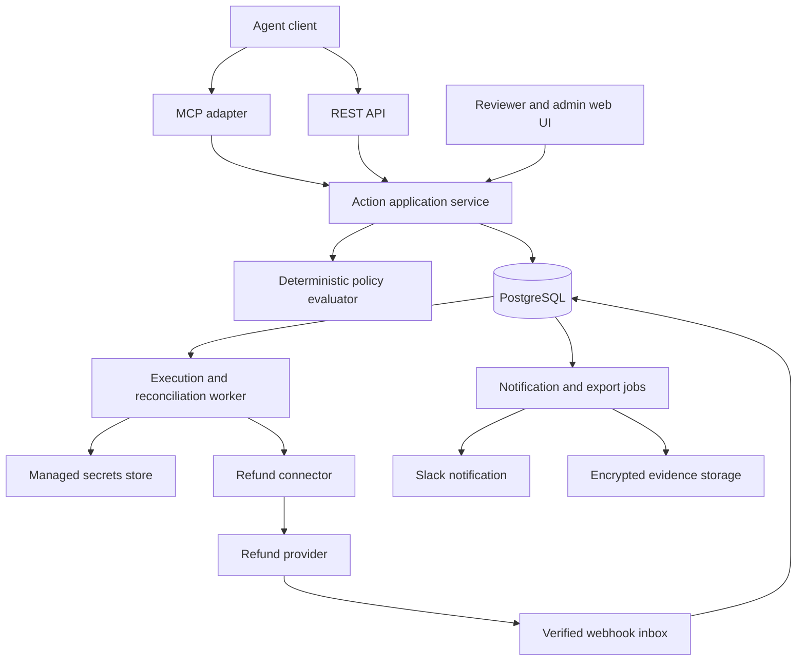

# Agent Policy Layer — Software Implementation Plan

Version 1.1 · October 10, 2026 · Rust backend

## 1. Purpose and scope

Build a service that receives proposed agent actions, evaluates deterministic policies, obtains required human approval, executes authorized actions, and records their outcomes.

This is the software-only companion to `agent-policy-layer-comprehensive-plan.md`. It excludes market research, sales, pricing, and company budgeting. It retains that plan’s initial scope: support-agent refunds through one provider, provisionally Stripe. The core action model should support future connectors without building a universal tool proxy in the first release.

Deliverables are a backend, durable execution worker, reviewer/admin interface, REST API, thin MCP adapter, refund connector, deployment configuration, tests, and operational runbooks. This document describes proposed software; no implementation currently exists in this workspace.

### MVP boundaries

| Included | Deferred |
|---|---|
| Refunds to the original payment route | Arbitrary payment recipients or transfers |
| One provider account per configured connection | Multi-provider orchestration and compensation |
| USD amounts in integer cents | Currency conversion and shared cross-currency limits |
| Agent, connection, and customer/order controls | General identity-provider product |
| One authorized reviewer per action | Multi-stage or quorum approval workflows |
| Web approvals and Slack notifications | Approval by email link or Slack button |
| REST and constrained remote MCP tools | Arbitrary HTTP, shell, browser, or MCP forwarding |
| Single-region hosted deployment | Active-active regions and custom on-premises support |
| Fixed daily UTC budgets | Arbitrary rolling windows and calendar configuration |

## 2. Correctness requirements

These invariants govern design, tests, and release decisions:

1. An action can execute only for an authenticated, enabled workload in the correct tenant and environment.
2. The agent cannot access the provider’s write credentials through the service.
3. The exact action dispatched is the one evaluated and, when required, approved.
4. Human approval cannot override a hard prohibition or create additional budget.
5. Committed spending plus active reservations cannot exceed any applicable gateway-controlled limit at reservation time.
6. An uncertain provider outcome cannot be treated as a confirmed failure or free its reservation automatically.
7. Duplicate submissions, callbacks, and jobs cannot create a new logical execution for the same idempotency key.
8. Every acknowledged state transition has a durable audit event.
9. Tenant identity comes from authentication, never from an agent-supplied field.
10. Policy publication, revocation, stop controls, and dispatch have defined ordering semantics.

The service cannot enforce limits over actions taken outside its execution boundary. Production onboarding must remove direct agent refund credentials and inspect alternate tools. Manual provider activity is reconciled for visibility, but an absolute organization-wide spending cap requires all relevant writes to share an authoritative reservation mechanism. The MVP promises gateway-controlled limits only.

## 3. Architecture



Use a modular backend with two process roles: API and worker. They share application/domain code and the database. The API never forwards an arbitrary agent request to a provider. The worker invokes a typed connector after completing dispatch checks.

### Proposed technology baseline

- Rust for backend, domain logic, execution/reconciliation workers, provider connectors, and MCP adapter. Use a Cargo workspace and pin a stable toolchain in `rust-toolchain.toml`.
- Axum for HTTP routing and Tokio for asynchronous I/O. Use Serde for explicit request/response and policy serialization, rejecting unsupported fields where appropriate.
- React, TypeScript, and Vite for the reviewer/admin interface. Node.js is frontend build tooling only; backend runtime processes are Rust binaries.
- PostgreSQL with SQLx for state, monetary reservations, audit events, webhook inbox, transactional outbox, and versioned SQL migrations. Keep critical locking and ledger queries explicit.
- OpenAPI generated from backend contracts, with a generated TypeScript client for the console. CI checks contract changes and regeneration; do not maintain duplicate handwritten frontend domain models.
- The official Rust MCP SDK (`rmcp`), subject to a remote authorization compatibility spike. MCP invokes the same Rust application service as REST.
- A narrow typed Stripe adapter using a validated Rust client or Reqwest HTTP calls. Pin the provider API version, verify webhook signatures against raw request bytes, and test reconciliation behavior in sandbox.
- Structured Rust tracing with redaction, metrics, and OpenTelemetry integration as needed.
- A managed OIDC provider for human authentication and standards-based workload tokens for agents.
- Managed secret storage for provider credentials and encrypted object storage for evidence exports.
- Containerized API and worker deployments; infrastructure defined as code.

These are project choices, not claims that a particular version or framework is required. Pin exact dependencies and protocol versions after a compatibility spike. Begin with database-backed job scheduling; add an external queue only when operational evidence justifies it. A queue never becomes the authority for permission to execute.

### Rust design and AI implementation discipline

Rust is selected to make compiler-enforced constraints part of the AI implementation feedback loop. Use newtypes for tenant/environment/action IDs and validated monetary values, enums for lifecycle states and provider outcomes, and exhaustive matches for transitions. Keep domain logic independent of HTTP and SQL. Use checked arithmetic for monetary totals and explicit conversions at database and JSON boundaries.

Compilation does not prove authorization, transaction ordering, or provider behavior. Preserve the concurrency, isolation, and failure-recovery tests in this plan. Avoid `unsafe` in application code, production `unwrap`/`expect`, and blanket lint suppression; handle errors explicitly and never classify a transport error as confirmed provider failure. Use types to express useful invariants without introducing unnecessary generic abstractions.

### Module responsibilities

| Module | Owns |
|---|---|
| Identity | Authentication, membership, workload grants, revocation |
| Actions | Submission, normalization, lifecycle, cancellation |
| Policies | Schema validation, evaluation, versioning, simulation, publishing |
| Approvals | Reviewer authorization, immutable binding, expiry, decisions |
| Budgets | Windows, reservations, settlement, adjustments |
| Execution | Dispatch authorization, attempts, retries, connector invocation |
| Reconciliation | Provider events, polling, unknown-outcome investigation |
| Evidence | Audit events, search, redaction, exports |
| Operations | Emergency stops, health, alerts, administrative recovery |

## 4. Repository and developer workflow

```text
Cargo.toml             # Rust workspace
Cargo.lock
rust-toolchain.toml
crates/
  api/                 # Axum executable
  worker/              # Execution/reconciliation executable
  contracts/           # Serde DTOs and OpenAPI definitions
  domain/              # Policies, state machine, authorization, ledger rules
  application/         # Shared use cases invoked by REST, MCP, and workers
  persistence/         # SQLx transactions and repositories
  connectors/          # Fake provider and narrow Stripe adapter
  mcp/                 # rmcp adapter
  telemetry/
apps/
  console/             # React/TypeScript/Vite and generated API client
migrations/
tests/
  integration/
  concurrency/
  fault-injection/
  end-to-end/
infra/
docs/
  architecture-decisions/
  threat-model/
  runbooks/
```

Provide local database startup, migrations, synthetic tenants, a deterministic fake provider, and a fake notification sink. Live provider secrets are optional for local work and required only for explicit sandbox integration tests. Seed data includes two tenants so isolation is exercised from the beginning.

CI runs `cargo fmt --all -- --check`, `cargo clippy --workspace --all-targets -- -D warnings`, and `cargo test --workspace`, plus frontend type/build checks, schema compatibility, migrations, database integration tests, dependency vulnerabilities, and accidental secrets. If SQLx checked-query macros are used, check committed offline query metadata against the migrated test database. Commit the application lockfile. The release pipeline also runs failure and concurrency tests. Keep security-sensitive architectural decisions in short decision records.

## 5. Identity and access control

### Agent identity

Validate issuer, audience, signature, expiry, and workload identity. Resolve tenant and environment from registered identity mappings. Require explicit grants for connection, action type, and status/evidence visibility. An initiating human identity must come from verified delegation; an optional agent-supplied label is merely metadata.

### Human roles

| Role | Permissions |
|---|---|
| Reviewer | View assigned actions and approve/reject within granted limits |
| Policy editor | Create drafts and run simulations |
| Policy publisher | Publish reviewed policy versions |
| Operator | Pause execution, inspect failures, request reconciliation |
| Auditor | Read permitted evidence and exports |
| Tenant administrator | Manage memberships, connections, and role grants |

Use a managed login flow, secure HTTP-only sessions, CSRF defenses for browser mutations, and explicit authorization on every endpoint. Operator access cannot mark a refund successful without provider evidence. Administrative access does not implicitly grant approval authority.

### Database isolation

Include `tenant_id` and `environment_id` throughout tenant-owned records. Use tenant-scoped composite foreign keys and unique constraints so references cannot cross tenants. Add row-level security as defense in depth, with tenant context set locally inside each transaction. Runtime roles must not own tables or hold bypass privileges; migration credentials remain separate.

PostgreSQL documents that superusers and `BYPASSRLS` roles bypass row security, and owners normally do too. Include tests under the actual runtime role rather than relying on development-owner tests. [PostgreSQL row-security documentation](https://www.postgresql.org/docs/current/ddl-rowsecurity.html)

## 6. Data model

All mutable aggregates have timestamps and a version counter for conditional transitions. Store money as integer minor units; accept only safe positive integer values within configured bounds. Store a normalized currency code explicitly.

| Entity | Key fields and constraints |
|---|---|
| `tenants`, `environments` | Status, retention configuration, execution-control epoch |
| `principals`, `memberships`, `workloads` | Verified identity mapping, grants, enabled status, authorization epoch |
| `connections` | Provider account identifier, secret reference, mode, enabled status; no plaintext credential |
| `policy_versions` | Immutable document, schema version, digest, author, publisher, publication time |
| `policy_bindings` | Active policy version for scope; monotonically increasing epoch |
| `actions` | Immutable normalized request, request digest, status, creator, connection, resource, expiry, row version |
| `submission_keys` | Unique tenant/environment/workload/key mapping to request digest and action |
| `context_snapshots` | Provider-derived fields, retrieval time, provenance, supported resource revision |
| `decisions` | Action, policy version, context reference, reasons, required approval, evaluation time |
| `approvals` | Action digest, policy version, reviewer, authority snapshot, expiry, decision; unique active decision per approval generation |
| `budget_windows` | Scope, currency, window start/end, limit, committed and reserved totals |
| `reservations` | Action/window/amount, status; unique reservation per action and applicable window |
| `execution_attempts` | Dispatch generation, provider key, request digest, start/finish, transport result, provider object ID |
| `provider_events` | Unique connection/provider-event ID, verified receipt, minimal payload, processing state |
| `audit_events` | Append-only tenant/action sequence, actor, transition, reason, redacted metadata |
| `outbox_jobs` | Job type, aggregate reference, available time, lease, attempts, deduplication key |
| `evidence_exports` | Scope, requester, object reference, expiry, completion status |

Keep request fields and execution parameters immutable. A changed amount or transaction creates a new action. Use ledger entries alongside cached budget totals; reconcile totals periodically and block affected scopes if they disagree. Adjustments are explicit events, never silent record edits.

## 7. API contracts

### Submit an action

`POST /v1/actions` with `Authorization` and `Idempotency-Key` headers:

```json
{
  "type": "refund.create",
  "connection_id": "conn_123",
  "resource": { "payment_id": "pay_123" },
  "parameters": { "amount_minor": 2500, "currency": "USD" },
  "metadata": { "support_case_id": "case_123" }
}
```

`payment_id` is a connector-normalized reference resolved to a verified provider payment. The schema excludes arbitrary destinations, endpoints, authorization claims, and raw provider options. Validate metadata length and treat it as untrusted display data.

Return `202 Accepted` after the action, submission-key mapping, initial audit event, and evaluation job are committed. Return an action ID, status URL, and current state. Admission does not mean permission or execution. Repeating a key with the same normalized request returns the same action; a changed request returns `409 Conflict`.

### Endpoint inventory

| Endpoint | Behavior |
|---|---|
| `GET /v1/actions/{id}` | Current state, safe decision reasons, approval need, provider outcome |
| `POST /v1/actions/{id}/cancel` | Conditional cancellation before dispatch authorization |
| `GET /v1/actions/{id}/events` | Authorized, paginated event timeline |
| `GET /v1/approvals` | Reviewer-scoped queue |
| `POST /v1/approvals/{id}/decision` | Approve/reject using expected version and digest |
| `POST /v1/policies/drafts` | Create immutable draft version |
| `POST /v1/policies/{id}/simulate` | Evaluate fixtures without reserving or executing |
| `POST /v1/policies/{id}/publish` | Publish with expected active-version precondition |
| `POST /v1/controls/pause` | Pause tenant, workload, or connection dispatch |
| `POST /v1/controls/resume` | Authorized and audited resume |
| `POST /v1/actions/{id}/reconcile` | Schedule evidence collection; no unconditional refund retry |
| `POST /v1/exports` | Asynchronous authorized evidence export |
| `POST /v1/provider-events/{connection_ref}` | Provider webhook verification and durable ingestion |

Use stable error codes such as `AUTHORIZATION_DENIED`, `IDEMPOTENCY_CONFLICT`, `APPROVAL_EXPIRED`, `BUDGET_EXCEEDED`, and `ACTION_ALREADY_DISPATCHED`. Distinguish malformed requests from admitted actions later denied by policy. Never return another tenant’s existence through detailed authorization errors.

MVP completion discovery uses polling with backoff. Defer customer callback delivery until polling is insufficient.

### MCP interface

Expose only `submit_refund`, `get_action`, and `cancel_action`. MCP calls use the same authentication grants and application service as REST. Return a durable action ID promptly; do not keep an MCP request open while awaiting a human. Require a stable client request key for submission. Reviewer and policy administration remain outside the agent tool surface.

Implement the selected remote MCP authorization profile and audience validation. Do not pass inbound access tokens through to Stripe. Pin the protocol and SDK compatibility matrix at build time. [MCP authorization specification](https://modelcontextprotocol.io/specification/2025-11-25/basic/authorization)

## 8. Policy implementation

Start with a small versioned, schema-validated JSON policy format. Support explicit fields and operators only; no arbitrary executable expressions. The evaluator is a pure function of normalized identity, action, authoritative context, and policy. Mutable budget admission remains transactional in the ledger.

Example configuration, with illustrative thresholds:

```json
{
  "schema_version": 1,
  "action": "refund.create",
  "currency": "USD",
  "automatic_limit_minor": 5000,
  "maximum_action_minor": 50000,
  "reviewer_role": "support_manager",
  "approval_ttl_seconds": 1800,
  "daily_connection_limit_minor": 200000,
  "daily_customer_limit_minor": 50000
}
```

Combine baseline prohibitions with scope rules conservatively: any hard deny wins; otherwise all applicable approval and limit requirements apply. The backend validates threshold consistency at publication. No matching policy means deny. Unavailable context means temporarily blocked, not allowed.

Every decision records policy version, context reference, stable reason codes, and evaluated constraints. Simulations show differences between current and proposed versions over synthetic or authorized historical snapshots. Historical replay cannot prove what mutable provider state would have been in a different execution history.

For MVP simplicity, any policy-version change invalidates pending approvals. Reevaluate and request approval under the new version when necessary. Policy rollback publishes a new version; it does not mutate historical policy records.

## 9. Action lifecycle and ordering

| State | Meaning | Permitted next states |
|---|---|---|
| `received` | Submission durably accepted | `evaluating`, `cancelled`, `expired` |
| `evaluating` | Acquiring context and checking rules | `denied`, `blocked`, `pending_approval`, `ready` |
| `blocked` | Temporary pre-dispatch condition | `evaluating`, `cancelled`, `expired` |
| `pending_approval` | Awaiting current-generation review | `ready`, `rejected`, `expired`, `cancelled`, `evaluating` |
| `ready` | Eligible for final dispatch checks | `dispatching`, `blocked`, `denied`, `pending_approval`, `cancelled`, `expired` |
| `dispatching` | Dispatch authorization committed; provider call may occur | `provider_pending`, `succeeded`, `failed_confirmed`, `outcome_unknown` |
| `provider_pending` | Provider accepted but result is not final | `succeeded`, `failed_confirmed`, `outcome_unknown` |
| `outcome_unknown` | Result cannot yet be established | `provider_pending`, `succeeded`, `failed_confirmed`, `manual_review` |
| `manual_review` | Automated reconciliation exhausted | `provider_pending`, `succeeded`, `failed_confirmed` with verified evidence |
| Terminal states | `denied`, `rejected`, `cancelled`, `expired`, `succeeded`, `failed_confirmed` | No generic retry transition |

Policy-version changes can return pre-dispatch actions to evaluation. All transitions use conditional updates and append audit events in the same transaction. A provider response being “pending” never becomes success merely because the API returned HTTP 200.

### Dispatch transaction

Fetch fresh provider context before opening the short database transaction. Then:

1. Lock action, applicable control/authorization records, active policy binding, and budget rows in a documented global order.
2. Confirm current state, unexpired action, enabled caller/connection, policy version, reviewer authority, and approval digest.
3. Confirm the context remains within the connector’s freshness bound; otherwise abandon the transaction and fetch again.
4. Reserve every applicable budget atomically. If any fails, reserve none.
5. Store the immutable provider request and stable idempotency key, transition to `dispatching`, and append audit/outbox events.
6. Commit, then call the provider. Never hold database locks across the network call.

The commit is the **dispatch authorization boundary**. Pause, cancellation, role revocation, and policy publication serialize against it using the same control rows/epochs. Changes committed first prevent dispatch; changes committed afterward cannot guarantee recall of an authorized request. The UI must say “already authorized/in flight” instead of claiming cancellation. Workers recheck stops immediately before sending where practical, but this cannot remove the final network race.

Local resource locks serialize gateway requests for a payment. Provider validation remains necessary because external writes cannot be locked by the gateway. A provider resource version is a precondition only if the provider supports enforcing it; a timestamp alone is not an atomic guarantee.

## 10. Monetary limits and retry safety

Use fixed UTC daily windows for the first release. Each action reserves against its connection and any configured agent/customer scopes. Create missing window rows safely under unique constraints and lock multiple windows in consistent order. Include active reservations when checking capacity.

Reservations stay assigned to their dispatch window even if settlement occurs later. Add a separate outstanding-exposure limit across all windows so unresolved actions cannot accumulate unlimited exposure across midnight. Record UTC boundaries explicitly in the UI. Lowering a limit below current usage blocks new commitments without rewriting past spending.

On confirmed success, move reserved value to committed value once. On confirmed non-execution, release it once. Unknown or provider-pending results retain the reservation. A stale lease is not evidence of non-execution.

Persist one provider idempotency key per logical action and immutable request parameters. Worker retries reuse them. Queue leases and fencing generations prevent stale local state updates; they cannot fence an external provider call. Provider idempotency supplies that part of duplicate protection.

Stripe describes partial refunds against a charge or payment intent and provider-side amount constraints. Its idempotency documentation defines replay and key-retention behavior. Capture those assumptions in connector tests; do not infer universal exactly-once delivery. [Stripe refund creation](https://docs.stripe.com/api/refunds/create), [Stripe idempotent requests](https://docs.stripe.com/api/idempotent_requests)

Before the provider’s safe retry interval expires, reconcile or safely replay the same key according to the connector contract. After it expires, disable automatic resend and require evidence-based reconciliation. Cross-key duplicate business requests are a separate concern: bound them using authoritative payment balance, customer/order cumulative rules, and optionally a verified business-request ID. A new random key is not proof of a new legitimate intent.

## 11. Connector and reconciliation contracts

Each connector implements:

```text
fetchContext(connection, resource) -> verified context and freshness metadata
buildRequest(action, context) -> normalized immutable provider request
execute(request, providerKey) -> confirmed result | pending | unknown
reconcile(action, attempts) -> verified current outcome or unresolved
verifyWebhook(rawBody, headers) -> verified event or rejection
capabilities() -> supported currencies, limits, retry semantics, lookup support
```

The Stripe adapter selects supported payment types during the spike and rejects unsupported cases explicitly. Restrict account access, distinguish sandbox/live mode, and tag provider objects with a safe action reference when supported. Never assume tags alone are unique or authoritative authorization.

Webhook verification precedes ingestion. Map the configured endpoint and verified provider account to a connection; do not trust an event-supplied tenant identifier. Persist deduplicated events before acknowledging receipt. Handle out-of-order events by retrieving current provider state where necessary.

Reconciliation runs after timeouts, for pending refunds, on incoming events, and periodically for stale nonterminal actions. Use bounded exponential backoff with jitter and provider-aware retry limits. Alert when unresolved age exceeds a connector-specific threshold. Manual review can attach verified evidence or initiate another provider lookup; it cannot erase reservations by declaration.

## 12. Reviewer and administrator interface

### Required screens

1. **Approval queue:** Filter by connection, amount, age, and assigned authority; show expiry.
2. **Action detail:** Exact immutable parameters, authoritative payment data, policy reasons, reviewer decision, budget exposure, execution timeline, and outcome.
3. **Policy editor:** Constrained form, validation, diff, simulation, and explicit publication.
4. **Connections and workloads:** Mode, scope, credential health, grants, revocation, and pause controls.
5. **Operations:** Unknown outcomes, stale jobs, reconciliation controls, and paused scopes.
6. **Evidence:** Tenant-scoped search and asynchronous export.

Approval binds tenant, environment, workload, connection, resource, action type, amount, currency, and policy version using a canonical representation and digest. The backend recomputes and checks it; a client-supplied hash alone is not trusted. Recheck reviewer authority at dispatch. Use expected row versions to reject stale decisions and resolve approve/reject races deterministically.

Slack notifications contain minimal metadata and link to the authenticated screen. GET requests and link previews never mutate state. Ticket text is escaped and visually separated from authoritative policy facts. Provide keyboard navigation, explicit confirmation of monetary amounts, and accessible state/error feedback.

## 13. Evidence, privacy, and observability

Append an audit event in the same transaction as every important state change, policy publication, approval, role change, stop, and export request. The application role cannot update or delete audit events. Privileged database access is separately logged; the product must not describe application-level immutability as protection against every infrastructure administrator.

Keep structured metadata by default. Exclude tokens, secret values, complete prompts, payment details not needed for control, and raw support transcripts. Define field redaction centrally and apply it to API errors, logs, traces, notifications, and exports.

Provisional retention: 90 days searchable operational metadata, configurable longer evidence storage, and separately documented backup retention. Retain an idempotency tombstone while replay is possible; expiring full records must not silently make old keys reusable. Define key lifetime and retention in the API contract before launch.

Metrics include submission latency, internal dispatch latency, decision counts by reason, approval age, reserved/committed totals, unknown-outcome age, reconciliation failures, queue lag, notification failures, and provider error rate. Correlate logs by tenant-safe action and trace IDs. Avoid high-cardinality sensitive dimensions in metrics.

Initial measured targets: p95 internal processing below 100 ms under the documented test load, excluding external calls and human waiting; service availability target 99.9% after hardening. Treat these as engineering targets until load tests and operating history support commitments.

## 14. Deployment and recovery

Use isolated development, staging, and production environments with different databases, secrets, provider modes, and identity audiences. Run at least two API replicas and independently scalable workers. Restrict provider credentials to execution components. Give the console/API no unnecessary provider write capability.

Roll out backward-compatible database migrations using expand/migrate/contract steps. Drain old workers before removing schema or state compatibility. A rollback cannot undo a provider action; connector behavior changes require explicit compatibility review.

| Dependency failure | Behavior |
|---|---|
| Database or audit persistence unavailable | No new acknowledged action or dispatch authorization |
| Required provider context unavailable | Block and retry within action lifetime |
| Policy invalid or missing | Deny; alert configuration owner |
| Login/approval service unavailable | Keep action pending |
| Slack unavailable | Retry notification; retain web queue |
| Provider timeout | Unknown outcome; retain reservation and reconcile |
| Object storage unavailable | Defer export while durable database remains healthy |

Enable encrypted backups and point-in-time recovery. Provisional disaster targets are RPO at most five minutes and RTO at most four hours, to be validated by drills. Start a restored system paused: reconcile provider-side actions against recovered records before resuming. Lost local records can otherwise cause duplicate execution despite a successful database restore.

Runbooks must cover credential exposure, cross-tenant access suspicion, provider outage, growing unknown-outcome queue, ledger mismatch, emergency pause/resume, backup restore, and rollback. Distinguish stopping future dispatch from recalling already-authorized calls.

## 15. Verification plan

| Suite | Critical cases | Pass condition |
|---|---|---|
| Domain | Policy boundaries, missing context, invalid currencies, precedence | Deterministic expected decision and reason |
| State machine | Duplicate events, stale versions, impossible transitions | Invalid transitions rejected |
| Ledger properties | Concurrent reservation, settlement, release, window rollover | No double settlement or over-admission |
| Isolation | Two tenants across every API, job, export, and database role | No cross-tenant access or references |
| Approval | Altered amount, expired decision, revoked reviewer, changed policy | Invalid authorization never dispatches |
| Idempotency | Same key/same body, same key/changed body, concurrent submission | One logical action or conflict |
| Fault injection | Crash before/after dispatch commit, provider success then timeout, stale worker | Reservations preserved and no unsafe new execution |
| Provider contract | Partial refund, pending/failure outcome, duplicate webhook, expired retry window | Correct provider-state mapping and retry restrictions |
| Control ordering | Pause/publish/revoke racing with dispatch | Behavior matches documented authorization boundary |
| Restore | Database restored behind provider state | Dispatch stays paused until reconciled |
| Browser/MCP | Approval workflow, status polling, grants, error handling | Same enforcement through every supported entry point |

Use a fake provider for repeatable failure schedules and the provider sandbox for API contract verification. Record load-test concurrency, dataset size, database sizing, and external-call exclusions. A passing suite validates supported scenarios rather than proving universal security.

## 16. Implementation milestones

Indicative schedule: 12 weeks for two experienced engineers with fractional security review. Adapt after the connector spike; correctness gates override dates.

| Milestone | Weeks | Deliverables | Exit criteria |
|---|---|---|---|
| M0: Contracts and feasibility | 1 | Threat model, connector spike, API schemas, state diagram, architecture decisions | Supported payment types, lookup/retry limits, and enforcement boundary documented |
| M1: Foundation | 2–3 | Repository, CI, database, authentication, two-tenant isolation, fake provider | Authenticated submission/status and isolation tests pass |
| M2: Policy and action lifecycle | 4 | Versioned rules, decisions, immutable requests, simulation, audit/outbox | Allow/deny flow works without provider writes |
| M3: Approval workflow | 5–6 | Reviewer UI, role checks, digest binding, expiry, Slack notification | Stale/replayed/unauthorized approvals cannot dispatch |
| M4: Controlled execution | 7–8 | Budget ledger, dispatch ordering, Stripe execution, stable retries | Concurrency and timeout-after-success tests pass |
| M5: Recovery and operations | 9–10 | Webhook inbox, reconciliation, exports, stop controls, dashboards | Failure drills and pending-outcome handling pass |
| M6: Release hardening | 11–12 | MCP adapter, load tests, restore drill, deployment docs, external review | Production readiness checklist complete |

Dependencies: identity and tenant isolation precede all workflows; immutable action contracts precede approvals; ledger and durable attempts precede live writes; reconciliation precedes production. REST/domain contracts allow MCP to be added without a second execution path.

### First vertical slice

Build one synthetic tenant/workload that submits a refund to the fake provider, passes a deterministic rule, creates a durable action/audit trail, and exposes status. Add a second tenant and prove isolation immediately. Then add approval, reservations, failure recovery, and the real connector in that order. Keep live provider execution disabled until the corresponding tests pass.

## 17. Release checklist and definition of done

- All supported actions use the same policy and execution path through REST and MCP.
- Agent credentials cannot invoke protected writes outside the configured boundary.
- Reviewer authentication, role revocation, approval binding, and expiry are enforced.
- Budget, idempotency, webhook, and state-machine concurrency tests pass.
- Unknown outcomes retain reservations and have an operational reconciliation path.
- No unresolved critical/high security finding affects the release deployment.
- Credential rotation, emergency stop, controlled resume, and database restore are demonstrated.
- Policy changes and dispatch races match documented semantics.
- Logs and exports pass secret/sensitive-field review.
- API/schema versions, connector limitations, retention, and support runbooks are documented.
- A staged production rollout uses low limits, a narrow action cohort, and daily reconciliation before expansion.

## 18. Decisions to resolve during M0

| Decision | Default | Required validation |
|---|---|---|
| Provider/payment types | Stripe, narrow supported types | Sandbox behavior and reconciliation lookup coverage |
| Workload identity issuer | Existing managed identity infrastructure | Token validation, issuance, revocation, and tenant mapping |
| Hosting/secrets provider | Team’s supported cloud | Private connectivity, backups, permissions, operational ownership |
| Context freshness | Connector-defined short bound | Latency and race analysis; no false atomicity claims |
| Idempotency retention | Long-lived mapping/tombstone | Provider retention and customer replay behavior |
| Reviewer revocation freshness | Local grant check at dispatch | Identity-provider sync and session-revocation behavior |
| Policy engine | Constrained typed evaluator | Keep behind an interface; revisit only for demonstrated rule complexity |

Resolve these through short technical spikes and decision records. None requires expanding the initial product into a universal agent gateway.
